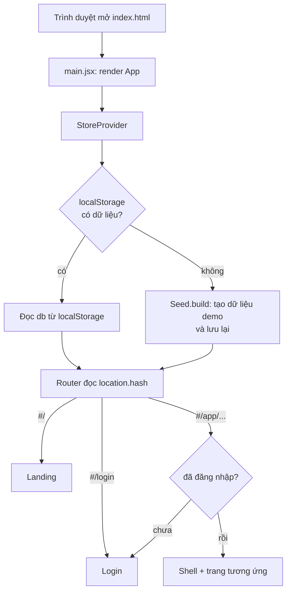
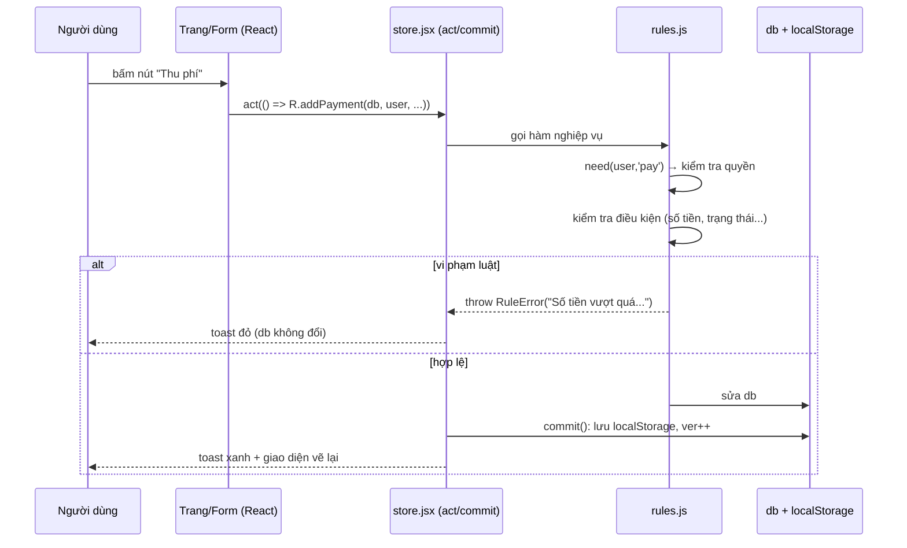
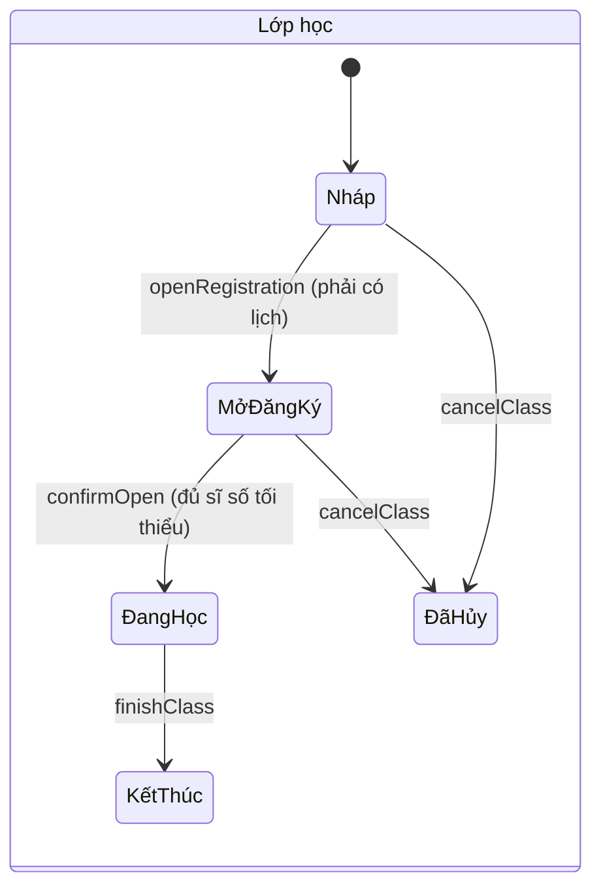
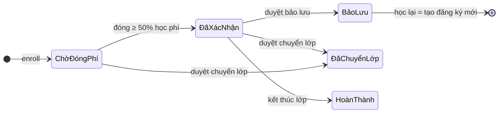
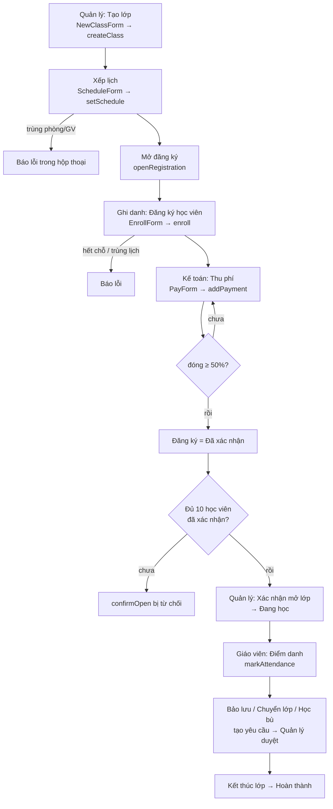

# Hướng dẫn code và luồng chạy – Web quản lý đào tạo Trung tâm tiếng Anh ABC (DT06)

Tài liệu này giải thích dự án được tổ chức thế nào, dữ liệu chảy ra sao khi bấm một nút, và cách thêm/sửa chức năng.

---

## 1. Công nghệ và cách chạy

| Thành phần | Dùng để |
|---|---|
| React 19 | Dựng giao diện bằng component |
| Vite | Chạy dev server, build |
| Tailwind CSS 4 | Tạo kiểu bằng class (không có file CSS riêng, trừ `src/index.css` cho hoạt ảnh) |
| localStorage | Nơi lưu dữ liệu (không có server/CSDL thật) |

```bash
npm run dev      # chạy thử, mở http://localhost:5173
npm test         # chạy 38 ca kiểm thử luật nghiệp vụ (không cần trình duyệt)
npm run build    # đóng gói vào thư mục dist/
```

Tài khoản demo (mật khẩu `123456`): `quanly`, `ghidanh`, `ketoan`, `gv1`, `gv2`.

---

## 2. Cấu trúc thư mục

```
abc-english-react/
├─ index.html              Trang gốc, nạp src/main.jsx
├─ run-tests.js            Chạy kiểm thử bằng Node (npm test)
├─ vite.config.js          Cấu hình Vite + React + Tailwind
└─ src/
   ├─ main.jsx             Điểm vào: gắn <App/> vào #root
   ├─ App.jsx              Router (hash) + khung quản trị (Shell) + menu theo vai trò
   ├─ store.jsx            Context: CSDL, người dùng, toast, hộp thoại, act/commit
   ├─ ui.jsx               Thành phần dùng chung: Btn, Badge, Card, Table, Form, Fld, In, Sel...
   ├─ fx.jsx               Hiệu ứng: Reveal, CountUp, Typewriter, Tilt, ScrollProgress, confetti()
   ├─ art.jsx              Hình minh họa động (HeroArt: quỹ đạo, bong bóng chào), Wave, dữ liệu nhận xét
   ├─ forms.jsx            Các hộp thoại nghiệp vụ (tạo lớp, thu phí, bảo lưu, chuyển lớp...)
   ├─ index.css            Tailwind + khai báo hoạt ảnh (keyframes)
   ├─ lib/
   │  ├─ rules.js          ★ TOÀN BỘ LUẬT NGHIỆP VỤ và phân quyền (không dính React)
   │  ├─ seed.js           Dữ liệu nền và dữ liệu demo
   │  ├─ tests.js          38 ca kiểm thử
   │  └─ util.js           Hàm nhỏ: by(), vnd, dmy, ROLE, TYPE, reqDesc...
   └─ pages/
      ├─ public.jsx        Trang giới thiệu (Landing) và Đăng nhập (Login)
      ├─ pages.jsx         Các trang quản trị: Dashboard, Lớp, Đăng ký, Học phí, Yêu cầu, Điểm danh...
      └─ master.jsx        CRUD chung: Học viên, Giáo viên, Chi nhánh, Phòng, Khóa học, Đợt
```

**Nguyên tắc quan trọng nhất:** giao diện (`pages`, `forms`) *không tự quyết định đúng/sai*. Mọi kiểm tra
(đủ sĩ số? trùng lịch? có quyền không?) nằm trong `lib/rules.js`. Giao diện chỉ gọi hàm rồi hiển thị kết quả.
Nhờ vậy cùng một luật được dùng cho cả web lẫn kiểm thử.

---

## 3. Luồng khởi động



- `useHash()` (trong `store.jsx`) lắng nghe `hashchange` và trả về mảng, ví dụ `#/app/class/cl_abc` → `['app','class','cl_abc']`.
- `Router` (trong `App.jsx`) chọn trang theo phần tử đầu: rỗng → Landing, `login` → Login, `app` → Shell.
- `Shell` kiểm tra vai trò: nếu menu của vai trò không có trang đó thì quay về Tổng quan.

Địa chỉ trang quản trị: `#/app/<trang>` với `dashboard, classes, timetable, students, enrollments, payments, requests, attendance, staff, master, leads, reports`; riêng chi tiết lớp là `#/app/class/<id>`.

---

## 4. Vòng đời dữ liệu: `db`, `commit`, `act`

Đây là phần cần hiểu kỹ nhất.

- `db` là **một object JavaScript** chứa các "bảng": `users, branches, rooms, courses, terms, teachers, students, classes, sessions, enrollments, payments, attendance, requests, reservations, leads`.
- Các hàm trong `rules.js` **sửa trực tiếp `db`** (ví dụ `db.enrollments.push(...)`).
- Sau khi sửa, React chưa biết để vẽ lại → gọi `commit()`: lưu `db` vào localStorage và tăng số `ver` để mọi component đọc lại.



- **`act(fn, thôngBáoThànhCông)`** (store.jsx): chạy `fn`, bắt lỗi. Lỗi nghiệp vụ → toast đỏ. Thành công → `commit()` + toast xanh. Dùng cho nút bấm trực tiếp (Mở đăng ký, Duyệt, Thu phí…).
- **`<Form onSubmit>`** (ui.jsx): dùng cho hộp thoại có ô nhập. `onSubmit(FormData)` trả về chuỗi thông báo hoặc `throw`. Lỗi hiện **ngay trong hộp thoại** (chữ đỏ) và hộp thoại không đóng; thành công thì đóng + `commit()` + toast.
- **`R.atomic(db, fn)`**: nếu `fn` ném lỗi giữa chừng, `db` được **khôi phục nguyên trạng** (kiểu transaction). Vì vậy chuyển lớp thất bại không để lại dữ liệu nửa vời.

> Lưu ý: khi `atomic` khôi phục, các đối tượng con trong `db` bị thay bằng bản sao mới. Đừng giữ tham chiếu cũ qua một lệnh có thể thất bại — hãy tra lại bằng id (`R.by(db,'enrollments',id)`). Đây là lý do một số ca trong `tests.js` có hàm `cur()`.

---

## 5. Mô hình dữ liệu

```mermaid
erDiagram
  BRANCH ||--o{ ROOM : có
  BRANCH ||--o{ CLASS : tổ_chức
  COURSE ||--o{ CLASS : mở_từ
  TERM ||--o{ CLASS : thuộc_đợt
  CLASS ||--o{ SESSION : gồm_buổi
  CLASS ||--o{ ENROLLMENT : có
  STUDENT ||--o{ ENROLLMENT : đăng_ký
  ENROLLMENT ||--o{ PAYMENT : đóng_phí
  SESSION ||--o{ ATTENDANCE : điểm_danh
  ENROLLMENT ||--o{ ATTENDANCE : của
  ENROLLMENT ||--o{ REQUEST : yêu_cầu
  ENROLLMENT ||--o| RESERVATION : bảo_lưu
  TEACHER ||--o{ SESSION : dạy
  ROOM ||--o{ SESSION : dùng
```

Ba khái niệm hay nhầm (đúng như kế hoạch DT06):

| Khái niệm | Bảng | Ví dụ |
|---|---|---|
| Khóa học (chương trình) | `courses` | "Giao tiếp A1 – Mất gốc", học phí 3.600.000 ₫, 24 buổi |
| Lớp học (mở cụ thể) | `classes` | `A1-CG-Q4-26-01` tại chi nhánh Cầu Giấy |
| Buổi học | `sessions` | Buổi 5, ngày 15/10, 18:00–19:30, phòng P101, giáo viên X |

**Đăng ký học (`enrollments`)** là bảng riêng nối học viên với lớp, vì có dữ liệu riêng (học phí áp dụng, trạng thái, ngày đăng ký). Mọi thay đổi quan trọng đều **giữ lịch sử** thay vì sửa đè:

- Chuyển lớp: đăng ký cũ → `Đã chuyển lớp`, tạo đăng ký mới có `transferredFrom`.
- Bảo lưu: đăng ký → `Bảo lưu` + tạo `reservations` (số tiền giữ lại, hạn).
- Tiền: mỗi lần thu là một dòng `payments`; số đã đóng = tổng các dòng, không lưu số tổng riêng.

### Vòng đời trạng thái





Yêu cầu (`requests`): `Chờ duyệt` → `Đã duyệt` hoặc `Từ chối`.

---

## 6. Luật nghiệp vụ (`lib/rules.js`)

Các con số nằm trong object **`CFG`** ở đầu file (đều là **giả định** cần giảng viên xác nhận):

| Hằng số | Giá trị | Ý nghĩa |
|---|---|---|
| `minStudents` | 10 | Sĩ số tối thiểu để mở lớp (tính học viên đã xác nhận) |
| `maxStudents` | 20 | Sĩ số tối đa |
| `minPaidPct` | 0.5 | Đóng ≥ 50% học phí mới được xác nhận chỗ |
| `maxReservePct` | 0.5 | Chỉ bảo lưu khi đã học ≤ 50% số buổi |
| `reserveMonths` | 3 | Thời hạn bảo lưu |
| `maxMakeup` | 2 | Số buổi học bù tối đa / đăng ký |
| `lateJoin` | 2 | Lớp đã học quá 2 buổi thì không nhận thêm |

Bảng hàm chính (đều nhận `db` và `user`; có kiểm tra quyền bằng `R.need`):

| Hàm | Làm gì | Từ chối khi |
|---|---|---|
| `createClass` | Tạo lớp Nháp, tự sinh mã lớp | không có quyền `klass` |
| `setSchedule` | Sinh đủ số buổi theo thứ trong tuần, lưu lịch | thiếu thông tin, phòng khác chi nhánh, ngày khai giảng ngoài đợt, **trùng phòng/giáo viên** |
| `updateClass` | Sửa khóa học/chi nhánh/đợt của lớp; nếu đổi thì lịch cũ bị xóa, mã lớp được tạo lại | lớp không còn Nháp, lớp đã có đăng ký |
| `deleteClass` | Xóa lớp và các buổi học | lớp không phải Nháp/Đã hủy, lớp đã có dữ liệu đăng ký (giữ lịch sử) |
| `saveUser` | Thêm/sửa tài khoản nhân viên (tên đăng nhập, vai trò, mật khẩu, giáo viên liên kết) | trùng tên đăng nhập, mật khẩu < 6 ký tự, giáo viên chưa gắn hồ sơ, tự hạ quyền, hạ quyền Quản lý cuối cùng |
| `deleteUser` | Xóa tài khoản | xóa chính mình, xóa Quản lý cuối cùng |
| `openRegistration` | Nháp → Mở đăng ký | chưa xếp lịch |
| `enrollCheck` | Điều kiện đưa học viên vào lớp, dùng chung cho ghi danh, chuyển lớp, học lại | học viên ngừng, lớp chưa mở, hết chỗ, trùng khóa/đợt, trùng lịch |
| `saveMaster` / `deleteMaster` | CRUD danh mục (học viên, giáo viên, chi nhánh, phòng, khóa, đợt) có kiểm tra sau trim và chặn sửa/xóa mục đang dùng | trường rỗng/sai định dạng, mục đang có lớp/lịch, đổi chi nhánh của phòng có lịch |
| `finishClass` | Kết thúc lớp | chưa học buổi nào; kết thúc sớm không có lý do |
| `confirmOpen` | Mở đăng ký → Đang học | **chưa đủ `minStudents` đã xác nhận**, lịch bị trùng |
| `enroll` (`_enroll`) | Tạo đăng ký, trạng thái Chờ đóng phí | lớp chưa mở, **đủ `maxStudents`**, đã đăng ký lớp/khóa này, **trùng lịch học viên**, vào muộn quá 2 buổi |
| `addPayment` | Ghi phiếu thu; đủ 50% → Đã xác nhận | quá số còn nợ, số dư không đủ, sai trạng thái |
| `createRequest` | Tạo yêu cầu bảo lưu/chuyển lớp/học bù sau khi kiểm tra điều kiện | vi phạm điều kiện từng loại, đã có yêu cầu chờ duyệt, thiếu lý do |
| `approve` | Duyệt (kiểm tra lại + thực thi, trong `atomic`) | không phải quản lý, điều kiện không còn đúng |
| `reject` | Từ chối (bắt buộc ghi lý do) | không phải quản lý |
| `resume` | Học lại sau bảo lưu, trừ học phí đã giữ | phiếu hết hạn, lớp khác khóa, lớp hết chỗ/trùng lịch |
| `markAttendance` | Điểm danh | giáo viên điểm danh buổi người khác, buổi chưa tới ngày |

Cách tổ chức yêu cầu đặc biệt (dễ mở rộng):

- `R.V[loại](db, data)` — **V**alidate: kiểm tra điều kiện, trả về "ngữ cảnh" (`{e, from, to, diff...}`).
- `R.X[loại](db, ctx, request)` — e**X**ecute: thực thi thay đổi sau khi duyệt.
- `createRequest` gọi `V`; `approve` gọi lại `V` rồi `X` (vì tình hình có thể đã thay đổi giữa lúc tạo và lúc duyệt).

Phân quyền: `PERMS` ánh xạ hành động → danh sách vai trò. `R.can(user,'pay')` trả đúng/sai; `R.need` ném lỗi nếu sai. Menu hiển thị theo `ROLE_MENU` (App.jsx) chỉ là **tiện cho người dùng**; kiểm tra thật nằm ở `R.need` trong `rules.js`.

---

## 7. Luồng nghiệp vụ từ đầu đến cuối



### 7.1 Mở lớp
1. `Lớp học → + Tạo lớp` (hộp thoại `NewClassForm`) → `R.createClass`.
2. Vào chi tiết lớp → `Xếp lịch` (`ScheduleForm`) → `R.setSchedule`: sinh 24 buổi từ ngày khai giảng, kiểm tra từng buổi với mọi buổi đã có (`resourceConflicts`).
3. `Mở đăng ký` → `R.openRegistration`.
4. Khi đủ học viên đã xác nhận, `Xác nhận mở lớp` → `R.confirmOpen`.

### 7.2 Đăng ký và học phí
`enroll` tạo đăng ký ở trạng thái **Chờ đóng phí** → kế toán `Thu phí` → khi tổng đã đóng ≥ 50% học phí, `R.refresh` đổi sang **Đã xác nhận** (lúc này mới được tính vào sĩ số mở lớp).

### 7.3 Bảo lưu
- Tạo (từ trang *Đăng ký học*): `R.V.reserve` kiểm tra đang học và đã học ≤ 50% số buổi.
- Duyệt: `R.X.reserve` → đăng ký thành `Bảo lưu`; học phí giữ lại = `đã đóng × (số buổi còn lại / tổng buổi)`; hạn 3 tháng.
- Học lại: hồ sơ học viên → `Học lại` → `R.resume` tạo đăng ký mới ở lớp cùng khóa, tự trừ khoản đã giữ.

### 7.4 Chuyển lớp
- `R.V.transfer` kiểm tra: lớp đích **cùng cấp độ** khóa, còn chỗ, không trùng lịch học viên.
- Duyệt (`R.X.transfer`, trong `atomic`): đăng ký cũ → `Đã chuyển lớp`; tạo đăng ký mới; tiền đã đóng chuyển sang (loại thanh toán `Chuyển nội bộ` để **không bị tính hai lần vào doanh thu**).
  - Lớp đắt hơn → học viên còn nợ phần chênh lệch.
  - Lớp rẻ hơn → phần dư cộng vào `student.balance` (số dư), dùng được cho lần thu sau (hình thức `Số dư`).
- Nếu lớp đích đầy lên giữa lúc tạo và lúc duyệt → duyệt báo lỗi, **mọi thứ giữ nguyên**.

### 7.5 Học bù
Chỉ cho buổi học viên bị ghi `Vắng`; buổi bù phải ở **lớp khác cùng khóa**, đang học, ở tương lai, còn chỗ (sức chứa phòng trừ sĩ số), không trùng lịch; tối đa 2 buổi/đăng ký. Khi giáo viên điểm danh buổi bù, học viên bù xuất hiện trong danh sách kèm nhãn "Học bù".

### 7.6 Điểm danh
Trang *Điểm danh* liệt kê các buổi trong 45 ngày qua (giáo viên chỉ thấy buổi của mình). Lưu → `R.markAttendance`; buổi chuyển `held = true`, được tính vào "đã học x/y buổi" (dùng cho luật bảo lưu).

---

## 8. Các thành phần giao diện dùng chung

| Thành phần (`ui.jsx`) | Dùng khi |
|---|---|
| `Btn`, `LinkBtn` | Nút; `v` = `pri/ghost/ok/bad/warn`, `sm` = nhỏ |
| `Badge t="Đã xác nhận"` | Nhãn trạng thái, tự chọn màu theo bảng `BC` |
| `Card`, `Note`, `H3` | Khung, ghi chú vàng, tiêu đề mục |
| `Table head rows right` | Bảng; `rows` là mảng `<tr>`, `right` = chỉ số cột canh phải |
| `Bar`, `Meter` | Thanh tiến độ; `Meter` xanh khi đạt mức tối thiểu |
| `Form` | Hộp thoại có biểu mẫu (xem mục 4); thêm prop `confirm="..."` để hỏi lại trước khi lưu |
| `Confirm`, `useAsk()` | Hộp thoại "Bạn có chắc chắn?" (thay `confirm()` mặc định của trình duyệt) |
| `Fld`, `In`, `Sel`, `Area`, `Filter` | Ô nhập, ô chọn, ô lọc |

`store.jsx` cung cấp qua `useStore()`: `db, user, setUser, commit, toast, act, reset, openModal, closeModal`.

Mở một hộp thoại: `openModal(<PayForm eid={e.id} />)` (xem các nút trong `pages.jsx`).

### Hộp xác nhận ("Bạn có chắc chắn?")

Mọi thao tác sửa/xóa/thay đổi trạng thái quan trọng đều hỏi lại trước khi thực hiện:

| Thao tác | Kiểu xác nhận |
|---|---|
| Xóa mục trong Học viên/Danh mục | Hộp cảnh báo đỏ, nêu rõ tên mục sắp xóa |
| Sửa mục trong Học viên/Danh mục | Thanh vàng ngay trong hộp thoại: "Bạn có chắc chắn muốn lưu thay đổi này?" – nút *Quay lại* giữ nguyên nội dung đã nhập |
| Thu học phí, từ chối yêu cầu, sửa lịch lớp đã có lịch | Thanh vàng trong hộp thoại (prop `confirm` của `Form`) |
| Mở đăng ký, xác nhận mở lớp, kết thúc lớp, hủy lớp, duyệt yêu cầu, khôi phục dữ liệu demo | Hộp xác nhận riêng, gọi bằng `useAsk()` |

Cách dùng:

```jsx
const ask = useAsk();
<Btn onClick={() => ask({ title: 'Bạn có chắc chắn?', message: '...', ok: 'Xóa', danger: true, onConfirm: () => act(() => ...) })}>Xóa</Btn>
```

Thao tác chỉ chạy khi người dùng bấm nút xác nhận; bấm *Hủy*, bấm ra ngoài hoặc đóng hộp thì không có gì thay đổi.

---

### Hiệu ứng và ảnh động (`fx.jsx`, `art.jsx`, `index.css`)

| Hiệu ứng | Ở đâu | Cách hoạt động |
|---|---|---|
| Hình minh họa động `HeroArt` | Trang chủ, trang đăng nhập | SVG/CSS thuần: biểu tượng quay trên hai quỹ đạo ngược chiều, lõi "ABC" lơ lửng, bong bóng chào "Hello!/Xin chào!" |
| Chữ tự gõ `Typewriter` | Tiêu đề trang chủ | Đổi lần lượt các cụm từ, dùng `setTimeout` |
| Thẻ nghiêng 3D `Tilt` | Thẻ khóa học | Đọc vị trí chuột, đặt biến CSS `--rx --ry --mx --my` → nghiêng và có ánh sáng theo con trỏ |
| Băng chuyền nhận xét | Trang chủ | Danh sách nhân đôi, `animate-marquee` chạy vô hạn, rê chuột thì dừng |
| `Reveal`, `CountUp`, `ScrollProgress` | Trang chủ, dashboard | Hiện dần khi cuộn tới, số đếm tăng, thanh tiến độ cuộn |
| Pháo giấy `confetti()` | Mở lớp, duyệt yêu cầu, đăng ký, thu phí, gửi tư vấn | Tạo phần tử rồi dùng Web Animations API; bật bằng tham số thứ 3 của `act(fn, msg, true)` hoặc prop `celebrate` của `Form` |
| Banner dashboard | Tổng quan | Nền chuyển màu, tay vẫy 👋, ngôi sao nhấp nháy |

Keyframes nằm trong khối `@theme` của `index.css`; thêm hiệu ứng mới bằng cách khai báo `--animate-ten` rồi dùng class `animate-ten`.
Hiệu ứng tự tắt nếu hệ điều hành bật "giảm chuyển động" (Windows: Settings → Accessibility → Visual effects → Animation effects).

---

## 9. Hướng dẫn mở rộng

### 9.1 Thêm một luật mới (ví dụ: học viên chỉ được bảo lưu 1 lần)
1. Mở `lib/rules.js`, thêm điều kiện vào `R.V.reserve`:
   ```js
   if (db.reservations.some((v) => v.studentId === e.studentId)) fail('Học viên đã bảo lưu một lần.');
   ```
2. Thêm ca kiểm thử trong `lib/tests.js` (mảng `cases`).
3. Chạy `npm test`. Không cần sửa giao diện — thông báo lỗi tự hiện trong hộp thoại.

### 9.2 Đổi con số quy định
Sửa trong `CFG` (đầu `rules.js`). Giao diện và thông báo đọc từ `CFG` nên tự cập nhật.

### 9.3 Thêm một thao tác mới (ví dụ: "Đổi giáo viên của lớp")
1. `rules.js`: viết `R.changeTeacher = (db,u,classId,teacherId) => { R.need(u,'klass'); return R.atomic(db, () => {...}); }` — kiểm tra rồi mới sửa.
2. `forms.jsx`: viết component `ChangeTeacherForm` dùng `<Form onSubmit>` gọi hàm trên.
3. `pages.jsx`: thêm nút `openModal(<ChangeTeacherForm id={id} />)`.

### 9.4 Thêm một danh mục CRUD (ví dụ: "Ca học")
Thêm một mục vào `MASTER` trong `pages/master.jsx` (cols = cột bảng, fields = ô nhập), thêm khóa vào mảng `keys` của `Master`, và tạo mảng rỗng tương ứng trong `Seed.minimal()`. Danh sách, thêm, sửa, xóa (có kiểm tra đang được dùng) chạy tự động.

### 9.5 Thêm một trang
1. Viết component trong `pages.jsx`, bắt đầu bằng `<Head title="..."/>`.
2. `App.jsx`: thêm vào `MENU`, `ROLE_MENU` (vai trò nào được xem) và `PAGES`.

### 9.6 Thêm vai trò / tài khoản
Tài khoản ở `Seed.minimal().users`; vai trò mới cần thêm vào `PERMS` (rules.js), `ROLE` (util.js) và `ROLE_MENU` (App.jsx). Muốn áp dụng dữ liệu seed mới: bấm "↺ Khôi phục dữ liệu demo" ở thanh bên (tài khoản quản lý) hoặc xóa localStorage.

---

### An toàn dữ liệu lưu trữ (`store.jsx`)

- **Nạp dữ liệu:** kiểm tra đủ các bảng; dữ liệu hỏng được sao lưu sang khóa riêng `..._corrupt_<thời điểm>` rồi nạp dữ liệu demo, không bao giờ xóa im lặng. Nếu tạo dữ liệu demo lỗi thì nạp dữ liệu nền (chưa có lớp) và báo trên màn hình.
- **`commit()` trả về true/false:** lưu thất bại (đầy bộ nhớ/bị chặn) thì hoàn tác thao tác và báo lỗi; chỉ khi lưu xong mới hiện "Thành công".
- **Phiên bản dữ liệu `meta.rev`:** mỗi lần ghi tăng 1; nếu dữ liệu đã bị tab khác sửa thì thao tác bị từ chối và tải bản mới. Sự kiện `storage` giúp các tab tự đồng bộ. Đây chỉ giảm rủi ro, không thay thế CSDL dùng chung.
- **`ErrorBoundary`** (App.jsx) chặn trang trắng, cho tải dữ liệu hiện tại hoặc nạp lại demo (có sao lưu bản cũ).
- Quản lý có nút **Sao lưu dữ liệu (JSON)** và **Nạp bản sao lưu** ở thanh bên.

---

## 10. Kiểm thử

- `npm test` chạy `run-tests.js`: import `tests.js` và chạy từng ca trên **CSDL mới** (`Seed.minimal()`), không đụng dữ liệu thật.
- Bộ kiểm thử chỉ chạy bằng dòng lệnh (trang web không còn mục kiểm thử).
- Mỗi ca có mã `BR-xx / FR-xx / NFR-xx` để đối chiếu **bảng truy vết** trong tài liệu M2 (ví dụ `BR-01` = luật mở lớp đủ sĩ số).
- Hàm hỗ trợ trong `tests.js`: `mkClass` (tạo lớp có lịch, mở đăng ký), `fill` (thêm n học viên và đóng phí), `throws(fn, /regex/)` (mong đợi bị từ chối), `eq` (so sánh).

---

## 11. Lỗi thường gặp

| Hiện tượng | Nguyên nhân / cách xử lý |
|---|---|
| Dữ liệu cũ, không thấy thay đổi seed | Dữ liệu đã lưu trong localStorage. Bấm "Khôi phục dữ liệu demo" hoặc xóa khóa `abc_center_db_react_v1` |
| Sửa `db` nhưng giao diện không đổi | Quên gọi `commit()`. Dùng `act(...)` hoặc `<Form>` — chúng tự gọi |
| Test lỗi lạ sau khi một lệnh bị từ chối | Giữ tham chiếu cũ qua `atomic` (xem lưu ý mục 4); tra lại bằng id |
| Số đếm/hiệu ứng không chạy | Tab đang ẩn (trình duyệt tạm dừng hoạt ảnh) — mở lại tab |
| Muốn đăng nhập mà không được | Tên/mật khẩu demo ở mục 1; phiên đăng nhập lưu trong `sessionStorage`, đóng tab là mất |

---

## 12. Giới hạn của bản demo (cần nói khi bảo vệ)

- Không có server: mật khẩu và dữ liệu nằm ở trình duyệt; phân quyền chỉ bảo vệ trong phạm vi ứng dụng này.
- Khi làm bản thật: giữ nguyên `lib/rules.js` làm lớp dịch vụ chạy trên server, thay `db` bằng CSDL (bảng tương ứng mục 5, các `atomic` thành transaction), dùng xác thực thật.
